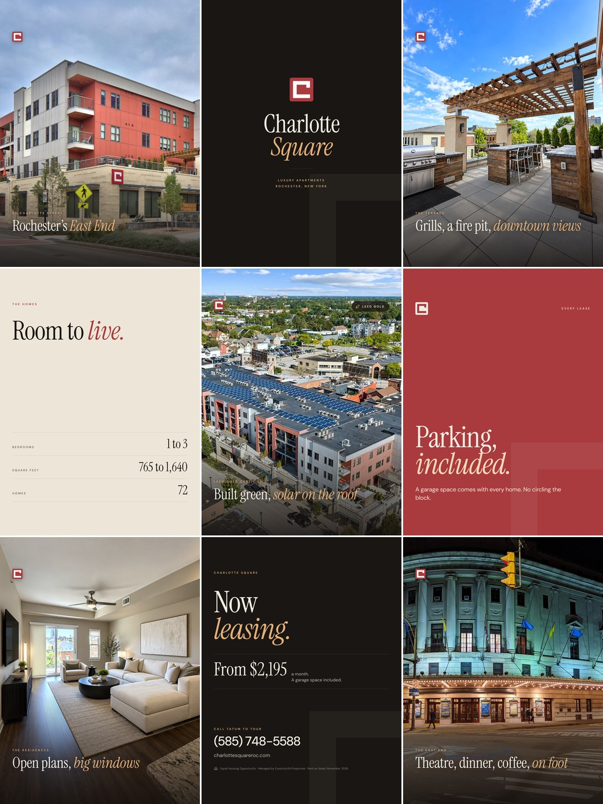

# Instagram: the nine-post grid and two Reels



Nine feed posts that read as one picture on the profile: photographs at the
corners and in the middle, the brand and the facts between them. Plus two
Reels with covers. Same type, colours and photographs as the website and the
social ads.

## What to upload

| Post in this order | File | Lands on the grid |
| --- | --- | --- |
| 1st | `post-01-east-end.jpg` | bottom right |
| 2nd | `post-02-leasing.jpg` | bottom middle |
| 3rd | `post-03-living.jpg` | bottom left |
| 4th | `post-04-parking.jpg` | middle right |
| 5th | `post-05-leed.jpg` | centre |
| 6th | `post-06-facts.jpg` | middle left |
| 7th | `post-07-terrace.jpg` | top right |
| 8th | `post-08-brand.jpg` | top middle |
| 9th | `post-09-exterior.jpg` | top left |

Instagram puts the newest post top left, so they go up in this order, which is
the reverse of how the grid reads.

- **Post the two Reels first, then the nine.** Then the nine are the newest
  and fill the top three rows exactly. For each Reel, set
  `reel-1-inside-cover.jpg` / `reel-2-east-end-cover.jpg` as its cover
  (Edit cover → Add from camera roll).
- **Keep the grid in threes afterwards.** Each later post moves everything
  along one place, so the picture stays whole only when posts go up three at a
  time. Unpin any pinned post, which would sit in front of the grid.
- **When uploading, choose the original 4:5 shape** (the crop button in the
  corner of the preview), not the square. The posts are 1440x1800.
- **Reels have no sound on purpose.** Add a track from Instagram's own library
  when posting: those are licensed for it, and Reels with sound get shown more.

## Nothing gets cut off

Instagram shows the same post at different crops, and keeps changing them: the
whole 4:5 in the feed, the middle 3:4 on the profile grid today, the middle
square on older apps and in some embeds. On Reels, the account bar, caption,
sound line and like/comment/share buttons cover the edges. So every page has
a safe area that sits inside all of those (`SAFE_POST`, `SAFE_REEL` and
`SAFE_COVER` in `make_instagram.py`). `render.cjs` measures every line of text
where it actually lands and **fails** if any falls outside the safe area,
naming the line. If Instagram changes its crops again, change those three
numbers and re-render: the check shows what needs to move.

## Suggested captions and alt text

1. **East End.** Theatre, dinner and coffee, all a short walk from your front
   door at 50 Charlotte Street. *Alt:* "A lit theatre facade at night on a
   Rochester East End street, with the words Theatre, dinner, coffee, on foot."
2. **Now leasing.** One- to three-bedroom homes from $2,195 a month, with a
   garage space in every lease. Call Tatum at (585) 748-5588 to tour. *Alt:*
   "Now leasing at Charlotte Square: from $2,195 a month, a garage space
   included. Call Tatum, (585) 748-5588."
3. **The residences.** Open plans and big windows. *Alt:* "A living room at
   Charlotte Square with a sectional sofa, wood floors and a window to the
   balcony."
4. **Parking, included.** Every lease comes with a garage space. *Alt:*
   "Charlotte Square: Parking, included. A garage space comes with every home."
5. **LEED Gold.** Built green and certified Gold, with solar panels on the
   roof. *Alt:* "Aerial photograph of Charlotte Square with solar panels across
   the roof, and a LEED Gold badge."
6. **The homes.** 72 homes, one to three bedrooms, 765 to 1,640 square feet.
   *Alt:* "Room to live: 1 to 3 bedrooms, 765 to 1,640 square feet, 72 homes."
7. **The terrace.** Grills, a fire pit and a view of downtown. *Alt:* "Charlotte
   Square's rooftop terrace with grills under a wooden pergola and a blue sky."
8. **Charlotte Square.** Luxury apartments in Rochester's East End. *Alt:*
   "The Charlotte Square logo: Luxury apartments, Rochester, New York."
9. **50 Charlotte Street.** *Alt:* "The red and grey four-storey Charlotte
   Square building on the corner of Charlotte Street."

**Reel 1, Inside the Square** (19 s): the lobby, the lounge, a living room,
the kitchen, a bedroom and the terrace, then the leasing card. *Caption:* "Come
on in. One- to three-bedroom homes in Rochester's East End, from $2,195 a
month. Call Tatum at (585) 748-5588 to tour."

**Reel 2, Your East End** (19 s): the building from above, Charlotte Street,
theatre nights, downtown, the pocket park, then the leasing card. *Caption:*
"Everything's a walk from 50 Charlotte Street. Now leasing, from $2,195 a
month."

The rent is the lowest on the website's live list in November 2026, and every
post that states it says so in its small print, beside the Equal Housing
Opportunity mark. Change `FROM_RENT` and `RENT_AS_OF` when it changes.

## Changing them

The copy, photographs and layout are in `make_instagram.py`, which writes the
HTML in `src/`. Then:

```bash
python3 marketing/instagram/make_instagram.py
node marketing/instagram/render.cjs
python3 marketing/instagram/make_reels.py
```

`render.cjs` needs Playwright, and `make_reels.py` needs Pillow and ffmpeg.
The intermediate PNGs go in `build/`, which is not kept in git.
